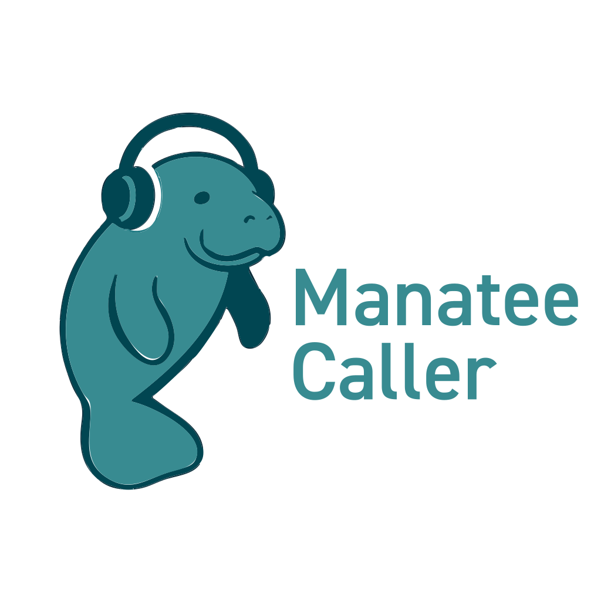

<p align="center">
  
</p>

<p align="center">
  
  
</p>

# ManateeCaller

**ManateeCaller** is an opt-in **WhatsApp voice-note art experiment** for **manatee lovers and enthusiasts**. People sign up, explicitly agree to be contacted on WhatsApp, and answer a few gentle questions with voice notes. When the interview completes, their combined answers become **one anonymous colour tile** in a growing shared mosaic.

> Consent-first and asynchronous: nobody is contacted without opting in. Raw audio is deleted after processing; transcripts are erased once the tile is created.

---

## How It Works

1. **Sign up** at `/` with name, WhatsApp number, 18+ confirmation, privacy notice, and the consent checkboxes. Signup stores the participant and does not write consent rows or send a WhatsApp template.
2. **Opt in on WhatsApp** — the colleague messages the keyword (default `I'm in`) to the existing number. That opens the 24-hour customer-service window. ManateeCaller records consent, starts the session, and replies with free-form messages only.
3. **Interview** — three short questions, each answered with a voice note.
4. **Voice → colour** — ElevenLabs transcribes each note; when all three are in, transcripts are combined and mapped to a colour via `HMAC-SHA-256`. Raw audio and transcripts are then deleted.
5. **Mosaic** — one anonymous tile appears at `/mosaic.html` (colour only).

---

## Tech Stack

- Node.js / TypeScript / Express
- Microsoft SQL Server (2022 or Azure SQL)
- Meta WhatsApp Business Cloud API
- ElevenLabs speech-to-text

---

## Setup

### Requirements

- Node.js 22 (`package.json` `engines.node` is `>=22 <23`)
- SQL Server (local Docker compose included)
- Meta WhatsApp Business app test number
- ElevenLabs API key
- ngrok or similar for webhooks locally

### Local SQL Server

`MSSQL_SA_PASSWORD` in `docker-compose.yml` and the `Password` in `DATABASE_URL` (`.env.example`) both use `YourStrong!Passw0rd`. That value is a local-only sample. If you change it, keep the two copies identical.

```bash
docker compose up -d
```

### Secrets (never commit real values)

```bash
cp .env.example .env
# Edit .env locally — do not commit this file
```

Required variables are documented in [`.env.example`](.env.example).

Generate encryption keys:

```bash
openssl rand -hex 32
```

### Install, migrate, run

```bash
npm install
npm run migrate
npm run dev
```

Open `http://localhost:3000` for signup. Point Meta webhooks to `https://<tunnel>/webhook/whatsapp`.

---

## API

| Endpoint | Description |
|---|---|
| `POST /api/signup` | Create participant and record consents. Does not send a template unless `WHATSAPP_TEMPLATE_INVITES_ENABLED=true` |
| `GET /api/mosaic` | List anonymous artwork tiles |
| `POST /api/erasure` | Disabled unless `ERASURE_ADMIN_TOKEN` is set, then requires `Authorization: Bearer`. Participants delete their data by texting `ERASURE_KEYWORD` (default `DELETE MY DATA`) from their own number |
| `GET/POST /webhook/whatsapp` | Meta webhook verification and inbound messages |
| `GET /health` | Health check (secrets redacted). `sha` is `DEPLOY_COMMIT_SHA` when that variable is set |

---

## Privacy (UK/EU pilot)

- Dual consent: WhatsApp contact + voice processing
- 18+ gate at signup
- Phone numbers encrypted at rest with separate lookup hash for deduplication/suppression
- Raw audio deleted after each voice note is processed
- Transcripts deleted after tile generation
- Reply `STOP` on WhatsApp to opt out (`unsubscribe`, `cancel`, and `opt out` too)
- ElevenLabs Zero Retention (`ELEVENLABS_ENABLE_ZERO_RETENTION=true`) required before claiming full third-party deletion — otherwise disclose provider retention in the privacy notice

See [`public/privacy.html`](public/privacy.html).

---

## Phase 1 internal pilot

Colleagues who have opted in message an existing WhatsApp Cloud API number. There is no approved `manatee_invite` template, so the app does not depend on sending one.

- `OPT_IN_KEYWORD` (default `I'm in`) starts consent and the session with free-form replies.
- `STOP`, `unsubscribe`, `cancel`, and `opt out` opt the sender out in every state, including when there is no session. Pending invites and jobs are cancelled. One confirmation is sent only while the 24-hour window is open. A later opt-in keyword can opt back in. Opted-out and blocked numbers are refused in the send path, next to the allowlist.
- `ERASURE_KEYWORD` (default `DELETE MY DATA`) from the sender's own number deletes their participant, consents, sessions, transcripts, and audio references, drops their webhook rows, and anonymises their mosaic tile. One confirmation is sent only while the window is open.
- Job payloads store the participant id, not the phone number. The invite outbox and every job recheck opt-out and blocked status before sending.
- `PILOT_ALLOWED_SENDERS` is a comma-separated E.164 allowlist. Inbound messages from other numbers are ignored and logged with the number masked. Outbound sends to other numbers are refused in code. An empty list allows nobody.
- `WHATSAPP_TEMPLATE_INVITES_ENABLED` defaults to `false`. The template outbox path runs only when this is `true`.
- `DEPLOY_SMOKE_MODE` or `DISABLE_BACKGROUND_JOBS` stops the background worker from polling. Leave both unset in normal operation. The deploy smoke test sets `DEPLOY_SMOKE_MODE=1`.

## Meta template

Template invites are off by default. When a template is approved, set `WHATSAPP_TEMPLATE_INVITES_ENABLED=true` and create a template named `manatee_invite` (or set `WHATSAPP_TEMPLATE_NAME`) that:

- Identifies **ManateeCaller**
- Explains the voice-note interview
- Includes a quick-reply button mapped to payload `IM_IN`
- Offers opt-out language

---

## Development

```bash
npm test          # unit tests
npm run typecheck
npm run build
npm start
```

CI runs tests, typecheck, build, and Gitleaks secret scanning on push and pull request. Every run packs `release.tar.gz` and smoke-tests `node dist/index.js` from that tarball with `DEPLOY_SMOKE_MODE=1`, so the background worker does not poll. Pushes to main upload it as the `deploy-manateecaller` artifact, kept for 3 days. Pull requests build and verify the same tarball and do not upload it.

---

## Production deploy

Prod runs under PM2. The release root is `/home/bitnami/nodeapps/manateecaller/manateecaller`. Slug and PM2 process name are both `manateecaller`.

```
/home/bitnami/nodeapps/manateecaller/manateecaller/
  current -> releases/<id>-<sha>/
  releases/<id>-<sha>/          # extracted release.tar.gz
    dist/                       # compiled app (node dist/index.js)
    public/                     # signup and mosaic static files
    migrations/                 # SQL applied by npm run migrate:prod
    node_modules/               # production dependencies, installed in CI
    package.json
    package-lock.json
    ecosystem.config.cjs        # PM2 app manateecaller, one instance
    .env -> ../../shared/.env   # host link, created at activate
  shared/
    .env                        # runtime env, never committed
```

GitHub Actions on `main` uploads one file, `release.tar.gz`, as the artifact `deploy-manateecaller` (3-day retention). The tarball root is that release directory. CI runs `npm ci --omit=dev` in a staging directory and packs the result, including production `node_modules`. The tarball contains no `.env` file. The host downloads the artifact and extracts it. Install and build stay in CI.

On the server, after extract:

```bash
npm run migrate:prod
pm2 start ecosystem.config.cjs --only manateecaller
```

`npm run migrate:prod` is `node dist/db/migrate.js`. It records applied filenames in `schema_migrations` and skips them on the next run, so running it again changes nothing.

`ecosystem.config.cjs` starts one fork of `dist/index.js` with `NODE_ENV=production`. When `DEPLOY_RELEASE_ROOT` is set, PM2 cwd stays on that path (the `current` symlink) instead of the real release directory. The process reads `.env` from that directory at startup. The host keeps the real file at `shared/.env` and links it into the release. Do not commit `shared/.env`.

### Environment variable names

Set these in `shared/.env`. Names only — values stay on the server.

Required:

- `PUBLIC_BASE_URL`
- `DATABASE_URL`
- `WHATSAPP_PHONE_NUMBER_ID`
- `WHATSAPP_BUSINESS_ACCOUNT_ID`
- `WHATSAPP_ACCESS_TOKEN`
- `WHATSAPP_APP_SECRET`
- `WHATSAPP_WEBHOOK_VERIFY_TOKEN`
- `WHATSAPP_TEMPLATE_NAME`
- `ELEVENLABS_API_KEY`
- `DATA_ENCRYPTION_KEY`
- `TILE_HMAC_KEY`
- `LOOKUP_HMAC_KEY`

Optional (the process starts without them; `NODE_ENV` is already `production` in the PM2 config):

- `PORT`
- `NODE_ENV`
- `WHATSAPP_API_VERSION`
- `ELEVENLABS_ENABLE_ZERO_RETENTION`
- `SESSION_TIMEOUT_HOURS`
- `MAX_VOICE_NOTE_BYTES`
- `MAX_VOICE_NOTE_SECONDS`
- `TEMP_AUDIO_DIR`
- `JOB_POLL_INTERVAL_MS`
- `WHATSAPP_TEMPLATE_INVITES_ENABLED` (default `false`)
- `OPT_IN_KEYWORD` (default `I'm in`)
- `PILOT_ALLOWED_SENDERS` (default empty — nobody is allowed)
- `ERASURE_KEYWORD` (default `DELETE MY DATA`)
- `ERASURE_ADMIN_TOKEN` (unset disables `POST /api/erasure`)
- `DEPLOY_SMOKE_MODE` (set to stop background polling)
- `DISABLE_BACKGROUND_JOBS` (set to stop background polling)

---

## License

MIT
